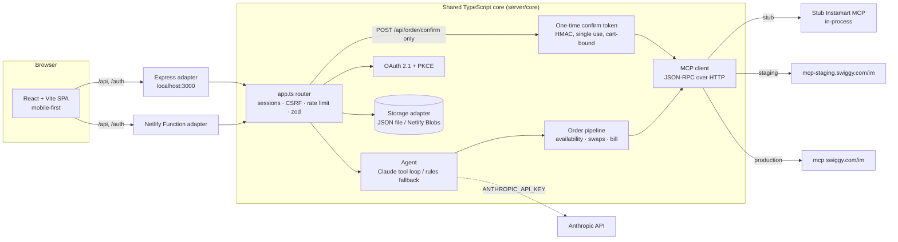

# Instamart Lists

A conversational grocery-list assistant for Swiggy Instamart. Chat to create named lists (L1, L2, “Weekly staples”), edit them in plain language, set a budget, and reorder a whole list with one confirmation. **Nothing is ordered until you tap “Confirm order.”**

Built for the Swiggy Builders Club (Instamart MCP). Instamart Lists is an independent app and is not an official Swiggy app.

```bash
npm install
npm run dev          # http://localhost:3000, stub mode, no credentials needed
```

---

## Features

| Feature | Where | Notes |
|---|---|---|
| Create a list from a sentence | Chat → “Found these for you” card | Picks the best variant by requested size and price; swap variant (bottom sheet), quantity steppers, Save as L1 / Discard |
| Edit a list in plain language | Chat → diff card | Add, remove, change quantity, rename, set or clear budget. Apply changes / Undo (Undo also reverts after applying) |
| My lists | Top bar → My lists | Badge, name, item count, first 3 items, estimated total, last ordered; expand, Order, Edit, Copy, Delete (inline “Delete? Yes / No”) |
| Budgets | List card, found card, order summary, or chat (“keep it under ₹150”) | Budget bar plus one-tap suggestions (cheaper variant or remove item) |
| Order a list | “Order this list” or chat (“Order L1”) | Checklist → summary → Confirm. Out-of-stock substitution (Accept / Remove item), “Price updated ₹49 to ₹52” tags, surge-fee banner (Order anyway / Cancel) |
| Success + tracking | Success screen | Order ID, Track order. ETA is shown only if the service response includes one |
| Save this as a list? | Success screen | After one-off orders or orders with substitutions |
| Voice input | Mic button | Web Speech API where the browser supports it |
| Light / dark themes | Moon button | Follows the system by default |

## Architecture



```
src/                 React app (screens, cards, PoweredByInstamart badge)
shared/              Types + constants used by both sides (brand text, cards, budget maths)
server/core/         Framework-agnostic backend (one handle(req) function)
  agent/             tools.ts (executors), llm.ts (Claude), rules.ts + parse.ts (offline)
  auth/              pkce.ts, oauth.ts
  mcp/               client.ts (JSON-RPC), stubTransport.ts
  order.ts           prepare / adjust / cancel / confirm / track
  confirmToken.ts    the checkout guard
server/express.ts    local adapter (Vite middleware in dev)
netlify/functions/   production adapter
stub/                fake Instamart MCP server + 47-product seed catalogue
tests/unit/          vitest: stub, PKCE, bill parsing, confirm guard, parser, API flow
tests/e2e/           Playwright: flows, layout, branding
```

### The safety guarantee: the model cannot place orders

- The agent’s tools are `search_products`, `draft_list`, `save_list`, `get_lists`, `edit_list`, `delete_list`, `prepare_order`, `get_cart`, `update_cart`, `clear_cart`. **There is no checkout tool.**
- `prepare_order` returns a bill preview plus a one-time **confirmation token** (HMAC-signed with `SESSION_SECRET`, bound to the user, the preview and a hash of the cart and bill, valid 10 minutes). The token goes to the browser and is never shown to the model.
- `checkout` is called from exactly one place: `confirmOrder()` behind `POST /api/order/confirm`, which the UI calls only when the user taps **Confirm order** or **Order anyway**. It rejects missing, forged, expired, reused or other-user tokens, a changed cart, and unresolved substitutions. The token is consumed before checkout, and checkout is never auto-retried.
- Deleting a list from chat shows an inline confirmation. Edits from chat are only proposals until you tap Apply changes.

### Agent modes

- **Claude** (when `ANTHROPIC_API_KEY` is set): server-side tool loop with the model from `ANTHROPIC_MODEL`. The system prompt tells it to state only facts returned by tools.
- **Rules** (no key): a deterministic parser that drives the same tools. This makes `npm run dev`, the demo and the tests work with zero credentials. It is also the fallback if a Claude call fails.

Cards (prices, stock, fees, ETA) are always built from Instamart tool responses, never from model text.

## Environment variables

| Variable | Required | Default | Purpose |
|---|---|---|---|
| `ANTHROPIC_API_KEY` | No | (empty → rules agent) | Claude agent, server-side only |
| `ANTHROPIC_MODEL` | No | `claude-sonnet-5-5` | Model name |
| `SWIGGY_MODE` | No | `stub` | `stub` \| `staging` \| `production` |
| `SWIGGY_REDIRECT_URI` | staging/prod | `http://localhost:3000/auth/callback` | Must exactly match an allowlisted URI |
| `SESSION_SECRET` | staging/prod | dev default (warns) | 32+ chars; signs session cookies and confirm tokens |
| `STUB_FLAGS` | No | | `oos,price,surge,eta,noeta` or `demo` |
| `SWIGGY_AUTH_BASE` | No | `https://mcp.swiggy.com` | OAuth server for discovery |
| `SWIGGY_CLIENT_ID` | No | | Skip dynamic client registration |
| `SWIGGY_MCP_URL` | No | per mode | Override the MCP endpoint |
| `SWIGGY_TRACK_LAT` / `SWIGGY_TRACK_LNG` | No | | Coordinates for `track_order` (see Known gaps) |
| `STORAGE` | No | `file` locally, `blobs` on Netlify | Storage adapter |
| `DATA_FILE` | No | `.data/store.json` | JSON store path (local) |

Copy `.env.example` to `.env`. The Express server reads `.env` automatically.

## Switching stub → staging → production

Only the base URL and auth change. No agent code changes.

| Mode | MCP endpoint | Auth |
|---|---|---|
| `stub` | in-process fake (also exposed at `POST /stub/mcp`) | none; “Continue in demo mode” |
| `staging` | `https://mcp-staging.swiggy.com/im` | OAuth 2.1 + PKCE |
| `production` | `https://mcp.swiggy.com/im` | OAuth 2.1 + PKCE |

1. Get your redirect URI allowlisted by Swiggy (email builders@swiggy.in). Exact match, no wildcards: `http://localhost:3000/auth/callback` for local, `https://<site>.netlify.app/auth/callback` for Netlify.
2. Set `SWIGGY_MODE=staging`, `SWIGGY_REDIRECT_URI=<the exact URI>`, `SESSION_SECRET=<32+ random chars>`.
3. Restart and tap **Sign in with your Swiggy account**.
4. When staging works, set `SWIGGY_MODE=production`.

### Stub scenarios

Use `?stub=oos,price,surge` in the URL, `STUB_FLAGS` in `.env`, or the **Demo scenarios** panel at the bottom of My lists (stub mode only):

- `oos`: Amul Taaza Toned Milk 500 ml is out of stock (substitution flow)
- `price`: Britannia White Bread 400 g goes from ₹49 to ₹52 (price-change tag)
- `surge`: a ₹25 surge fee on the bill (amber line + banner)
- `eta` / `noeta`: force the ETA on or off (default alternates per order)
- `demo`: `oos,price,surge`

Create lists with flags off, then turn flags on before ordering. Otherwise the list is built from the already-changed catalogue and there is nothing to flag.

## OAuth flow (staging / production)

```
Browser            Instamart Lists server                     mcp.swiggy.com
  | GET /auth/login        |                                         |
  |----------------------->| GET /.well-known/oauth-authorization-server
  |                        |---------------------------------------->|
  |                        | POST /auth/register (once, cached)      |
  |                        |---------------------------------------->|
  |                        | verifier, S256 challenge, state → session (server-side)
  | 302 /auth/authorize?response_type=code&client_id&redirect_uri    |
  |     &code_challenge&code_challenge_method=S256&state&scope=mcp:tools
  |----------------------------------------------------------------->|
  |                  user signs in with phone + OTP                  |
  | 302 /auth/callback?code&state                                    |
  |----------------------->| verify state (single use, <10 min)      |
  |                        | POST /auth/token {grant_type, code,     |
  |                        |   code_verifier, redirect_uri, client_id} (JSON)
  |                        |---------------------------------------->|
  |                        | store access/refresh token per user ID  |
  | 302 /                  |                                         |
```

- Auth codes are single use and expire in 120 seconds, so the callback exchanges immediately.
- Access tokens last 5 days (`expires_in`). The server refreshes when 60 seconds or less remain and stores the rotated refresh token.
- On 401/419 or JSON-RPC `-32001`, the token is cleared and the user is sent back to the welcome screen with a friendly message. 429 and 5xx are retried with backoff (`Retry-After` respected), except `checkout`, which is never retried.
- Tokens are never logged. The logger redacts token, cookie and secret keys.

## Security

- httpOnly, `SameSite=Lax` session cookie (`Secure` in production) holding only a signed session ID. PKCE material and tokens stay server-side.
- CSRF: OAuth `state` plus a required `X-Requested-With` header on every API POST.
- Rate limits per user and IP: chat 30/min, confirm 10/min, other API 120/min, login 20/min.
- zod validation on every endpoint body. 64 KB body limit.
- Security headers (CSP, HSTS, nosniff, frame-deny) in `netlify.toml`.
- Stored data: user ID, OAuth token, lists, plus short-lived drafts, edits and previews. Nothing else.
- Every request gets an `x-request-id` (logged and returned). Unexpected tool failures are reported to Swiggy via `report_error` with that ID.

## Testing

```bash
npm test                    # 58 unit tests (vitest)
npm run test:e2e            # 16 Playwright tests (flows, layout, branding)
CHROME_PATH=/usr/bin/google-chrome npm run test:e2e   # use a system Chrome
npm run build               # typecheck + production build
npm run check:brand         # verify the logo file
node scripts/walkthrough.mjs screenshots   # screenshots of the whole flow (dev server running)
```

## Verified against the Swiggy docs, and known gaps

Tool names and argument shapes were checked against the Builders Club reference (search_products, get_cart, update_cart, checkout, track_order, get_addresses, get_orders, your_go_to_items, report_error) before coding. The stub mirrors those shapes:

- `search_products` returns `products[].variations[]` with `spinId`, `quantityDescription`, `price.offerPrice`, `isInStockAndAvailable`.
- The cart bill is `billBreakdown.lineItems[{label, value}]` + `toPay`. There are no fixed fee fields, so `server/core/bill.ts` classifies lines by label (item total, handling, delivery/FREE, surge) and keeps any unknown line as-is.
- `checkout` takes `addressId` and optional `paymentMethod`. The docs list no ETA field on checkout. The stub adds an optional `etaText` so the UI is tested with and without one. Real ETAs come from `track_order` (`status.etaText` / `etaMinutes`).

Not yet verified live (no credentials in this environment). Check these during staging:

1. **`tools/list` on staging.** Run it once signed in and compare it to `INSTAMART_TOOLS` in `shared/instamart.ts`.
2. **Dynamic client registration body.** The docs don’t list the fields. We send `client_name`, `redirect_uris`, `grant_types`, `response_types`, `token_endpoint_auth_method: none`, `scope`. If Swiggy issues you a client ID instead, set `SWIGGY_CLIENT_ID`.
3. **Staging OAuth host.** Discovery defaults to `https://mcp.swiggy.com`. Set `SWIGGY_AUTH_BASE` if staging uses its own.
4. **`track_order` needs `lat`/`lng`**, which `get_addresses` doesn’t return. Set `SWIGGY_TRACK_LAT/LNG`. Without them, tracking falls back to `get_orders` status.
5. **Payment.** The stub returns Cash. Real carts may need `get_payment_options` (not wired yet). Checkout currently passes the first method from the cart, or nothing (the account default).
6. **Cart value cap.** The checkout docs mention a limit for larger orders. The app surfaces the service error but doesn’t pre-check a number.
7. **Rate limiting is per instance** on Netlify (in-memory). Fine for a prototype; use a shared store for scale.

See [DEPLOY.md](DEPLOY.md), [DEMO.md](DEMO.md) and [BRAND.md](BRAND.md).
